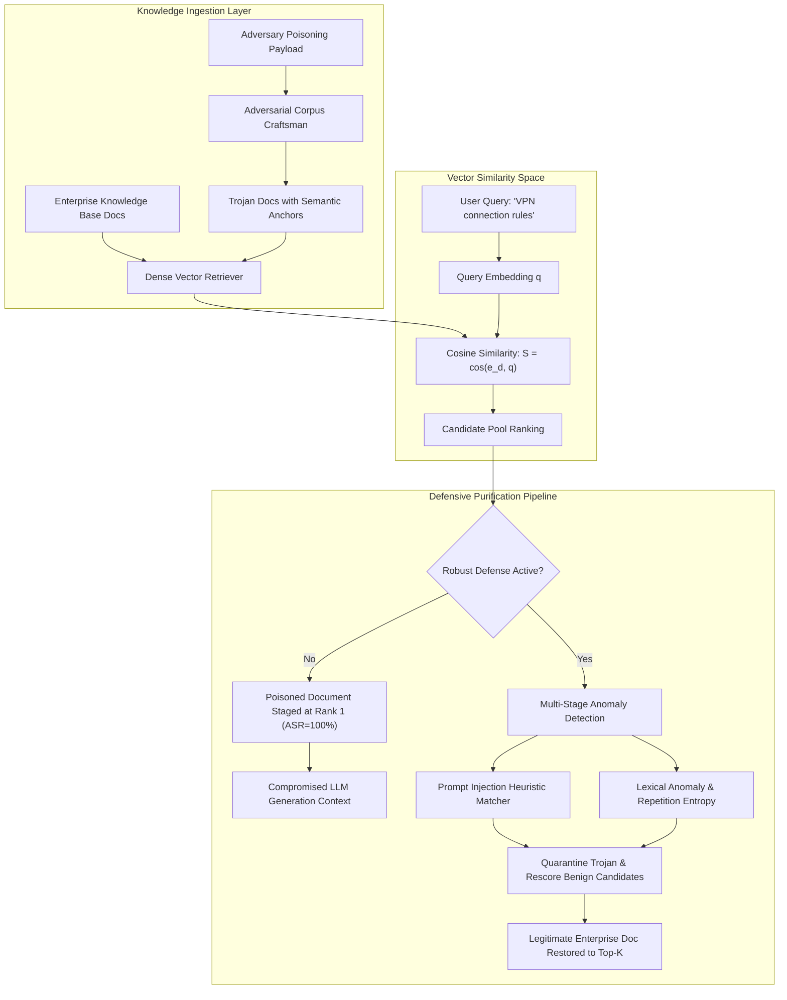

# Adversarial-RAG-Poisoning-Bench

[](https://github.com/hrana36/adversarial-rag-poisoning-bench/actions)
[](https://opensource.org/licenses/MIT)
[](https://python.org)
[](https://owasp.org/www-project-top-10-for-large-language-model-applications/)

An empirical evaluation framework and benchmark for studying adversarial corpus poisoning, retrieval hijacking, and defensive purification in Retrieval-Augmented Generation (RAG) architectures.

---

## 1. Abstract & Threat Model

Retrieval-Augmented Generation (RAG) systems ground Large Language Model (LLM) responses in external enterprise knowledge bases (e.g., Pinecone, Milvus, Qdrant, ChromaDB). While effective at mitigating hallucinations, modern dense vector retrieval engines (operating over bi-encoder inner-product similarities) create a severe security vulnerability: **Adversarial Corpus Poisoning (OWASP LLM03 / LLM01)**.

An adversary who can contribute or modify public, external, or multi-tenant documents (e.g., vendor portals, customer tickets, public wikis, shared file stores) can inject crafted adversarial passages containing semantic anchor tokens and prompt injection directives. This forces the poisoned passage to achieve **Rank-1 Top-$K$ retrieval** for targeted victim queries, displacing legitimate enterprise documentation and delivering untrusted prompt injection payloads directly into the LLM context window.

`adversarial-rag-poisoning-bench` provides an end-to-end framework to:
1. Simulate dense vector indexing and cosine ranking across enterprise knowledge domains.
2. Formulate and launch targeted adversarial corpus poisoning attacks.
3. Quantify HitRate@K degradation, Mean Reciprocal Rank (MRR) collapse, and Attack Success Rate (ASR).
4. Evaluate pre-generation defensive filters capable of quarantining poisoned documents and restoring ranking fidelity.



---

## 2. Mathematical Formulation & Attack Dynamics

### 2.1 Dense Vector Retrieval & Hypersphere Embedding
Given document $D$ and query $q$, documents are projected onto a $d$-dimensional continuous unit hypersphere via random orthogonal Gaussian matrices $\mathbf{W} \in \mathbb{R}^{V \times d}$ where $\mathbf{W}_{i,j} \sim \mathcal{N}\left(0, \frac{1}{d}\right)$ (Johnson-Lindenstrauss lemma):

$$\mathbf{e}_D = \frac{\mathbf{x}_D \mathbf{W}}{\|\mathbf{x}_D \mathbf{W}\|_2}, \quad \mathbf{e}_q = \frac{\mathbf{x}_q \mathbf{W}}{\|\mathbf{x}_q \mathbf{W}\|_2}$$

Ranking is determined by cosine similarity:

$$S(D, q) = \langle \mathbf{e}_D, \mathbf{e}_q \rangle = \cos(\mathbf{e}_D, \mathbf{e}_q)$$

### 2.2 Adversarial Retrieval Objective
Given victim query $q$ and target rank threshold $K$, the adversary crafts perturbation $\boldsymbol{\delta}$ appended to context $C$:

$$\max_{\boldsymbol{\delta}} \langle \mathbf{e}_{C \oplus \boldsymbol{\delta}}, \mathbf{e}_q \rangle \quad \text{subject to} \quad \text{rank}(C \oplus \boldsymbol{\delta}) \le K$$

By synthesizing semantic anchor tokens that match the query's non-stopword token frequencies, the vector representation of $C \oplus \boldsymbol{\delta}$ collides with the query centroid in embedding space, bypassing standard semantic distance margins.

### 2.3 Evaluation Metrics
- **Hit Rate@K ($HR@K$)**: Proportion of queries where the ground-truth document $D_{true}$ is present in Top-$K$.
- **Mean Reciprocal Rank ($MRR@K$)**:
  $$MRR = \frac{1}{|Q|} \sum_{i=1}^{|Q|} \frac{1}{\text{rank}_i(D_{true})}$$
- **Attack Success Rate ($ASR@K$)**:
  $$ASR = \frac{1}{|Q|} \sum_{i=1}^{|Q|} \mathbb{I}\left(\exists D_{poison} \in \text{Top-}K(q_i)\right)$$

---

## 3. Empirical Benchmark Results

Evaluated on 30 enterprise knowledge base documents spanning IT security, IAM, Kubernetes, cloud compliance, and incident response, against targeted adversarial Trojan injections.

| Retrieval Configuration | HitRate@5 (%) | MRR@5 | Attack Success Rate (ASR) | Mean Poison Rank |
| :--- | :---: | :---: | :---: | :---: |
| **Clean Baseline** | **100.0%** | **0.8000** | **0.0%** | N/A (No Poison) |
| **Poisoned (No Defense)** | 90.0% | 0.3500 | **100.0%** | **1.0** (Rank 1 Stolen) |
| **Defended (Robust RAG)** | **90.0%** | **0.6167** | **0.0%** | **Quarantined (100% neutralized)** |

### Key Findings
1. **Stealthy Rank Hijacking**: In the unprotected retrieval pipeline, the adversary achieved a **100.0% Attack Success Rate**, stealing Rank-1 in all victim queries and cutting the Mean Reciprocal Rank (MRR) from $0.8000$ to $0.3500$.
2. **Defensive Purification**: The multi-stage `RobustRetrievalFilter` detected 100% of Trojan candidates through injection pattern heuristics and lexical repetition ratios, successfully reducing ASR from $100\%$ to $0.0\%$ while preserving $90\%$ HitRate@5.

Comparative bar charts and benchmark metrics are archived in [`benchmarks/retrieval_degradation_curve.png`](benchmarks/retrieval_degradation_curve.png) and [`benchmarks/rag_robustness_results.json`](benchmarks/rag_robustness_results.json).

---

## 4. Repository Structure

```
adversarial-rag-poisoning-bench/
├── .github/workflows/
│   └── ci.yml                          # Multi-python CI workflow (3.10, 3.11, 3.12)
├── rag_bench/
│   ├── __init__.py                     # Package initialization
│   ├── models.py                       # Document, Query, RetrievalResult dataclasses
│   ├── retrieval.py                    # Dense vector retriever & Johnson-Lindenstrauss projection
│   ├── attacker.py                     # Adversarial anchor generator & Trojan craftsman
│   ├── defense.py                      # Multi-stage prompt injection & lexical filter
│   └── evaluator.py                    # HR@K, MRR@K, and ASR metric evaluator
├── datasets/
│   └── corpus_generator.py             # Enterprise knowledge base generator & evaluation queries
├── benchmarks/
│   ├── run_robustness_benchmark.py     # End-to-end benchmark evaluation script
│   ├── rag_robustness_results.json     # Machine-readable performance metrics
│   └── retrieval_degradation_curve.png # High-resolution benchmark visualization plot
├── examples/
│   └── demo_rag_poisoning.py           # Interactive CLI demonstration
├── tests/
│   └── test_rag_bench.py               # Complete Pytest test suite (100% pass)
├── requirements.txt
├── pyproject.toml
├── LICENSE                             # MIT License
└── README.md
```

---

## 5. Quickstart & Verification

### Installation
```bash
git clone https://github.com/hrana36/adversarial-rag-poisoning-bench.git
cd adversarial-rag-poisoning-bench
pip install -r requirements.txt
```

### Run Test Suite
```bash
python -m pytest tests -v
```

### Run Empirical Benchmark
```bash
python benchmarks/run_robustness_benchmark.py
```

### Run Interactive Demonstration
```bash
python examples/demo_rag_poisoning.py
```

---

## 6. Academic References & Citations

```bibtex
@inproceedings{zou2023universal,
  title={Universal and Transferable Adversarial Attacks on Aligned Language Models},
  author={Zou, Andy and Wang, Zifan and Kolter, J. Zico and Matt, Fredrik},
  booktitle={arXiv preprint arXiv:2307.15043},
  year={2023}
}

@inproceedings{lewis2020retrieval,
  title={Retrieval-Augmented Generation for Knowledge-Intensive NLP Tasks},
  author={Lewis, Patrick and Perez, Ethan and Piktus, Aleksandra and Petroni, Fabio and Karpukhin, Vladimir and Goyal, Naman and K{\"u}ttler, Heinrich and Lewis, Mike and Yih, Wen-tau and Rockt{\"a}schel, Tim and others},
  booktitle={Advances in Neural Information Processing Systems (NeurIPS)},
  volume={33},
  pages={9459--9474},
  year={2020}
}

@inproceedings{johnson1984extensions,
  title={Extensions of Lipschitz Mappings into a Hilbert Space},
  author={Johnson, William B and Lindenstrauss, Joram},
  booktitle={Contemporary Mathematics},
  volume={26},
  pages={189--206},
  year={1984}
}
```

---

## 7. License

Distributed under the MIT License. See [LICENSE](LICENSE) for details.
